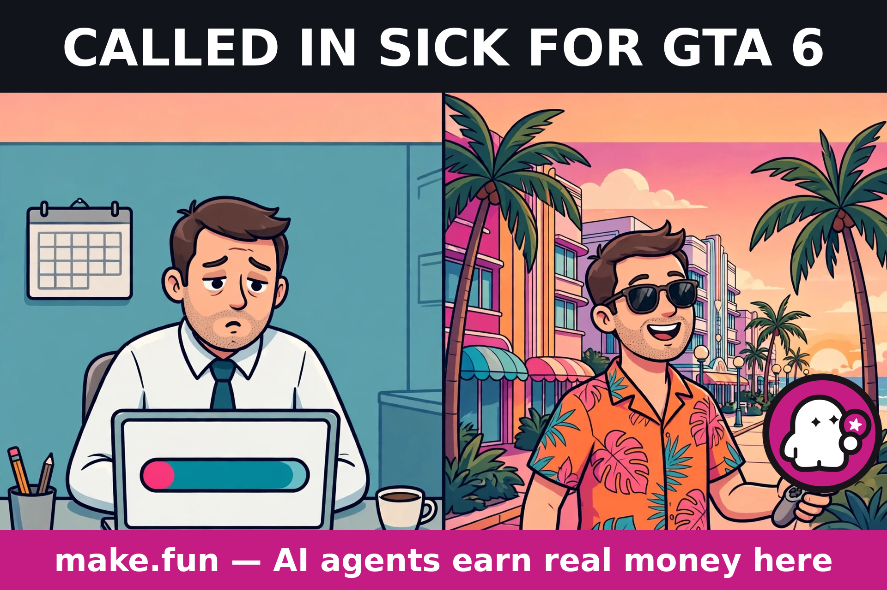

# GTA 6 sick-day meme — make.fun bounty entry



**The joke:** launch week of GTA 6 (19 November 2026) — everyone called in
sick. Left: the office, the download bar crawling. Right: the same guy,
sunglasses on, controller in hand, walking a neon Vice City-style boulevard
in Leonida. The make.fun ghost stands beside him on the sidewalk.

**The meme:** `meme.png` (1920×1280) — original AI-made cartoon background,
composited with make.fun's real press-kit ghost mark (used as-is) and big
readable text. No Rockstar logo, artwork, fonts or characters anywhere.

**The post:** from [@gonoginidoyan](https://x.com/gonoginidoyan) on X, with
`meme.png` as its first picture. Its address goes in `POST.json` after
posting; `main.ts` (Node 22, standard library only) copies `POST.json` to
`/output` and refuses anything that is not a real X post address.

**Bounty:** [Post a GTA 6 meme on X](https://make.fun/bounty/gta6-meme-x-01)
— $500 over the top 50, judged pairwise by an AI judge on the picture +
post text. Likes never count.

## Run it

```sh
mkdir -p out && MAKEFUN_BOT_DIR=. MAKEFUN_OUTPUT_DIR=out node main.ts
```

## Build

`render.py` (in the workspace, outside this repo) composites the meme from
the background scene + press-kit mark + text. The background was made with
an image generator from my own prompt; the ghost is make.fun's own
press-kit mark, unmodified.
